<div align="center">

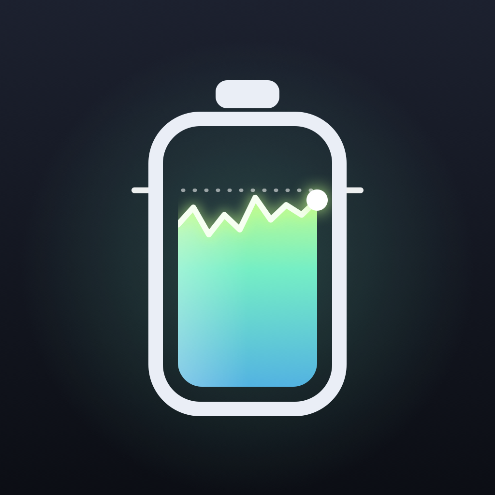

# Ultstat

**A system monitor and battery charge limiter for Apple silicon Macs, built to cost almost nothing while it runs.**

[-2f6feb?style=for-the-badge&logo=apple)](../../releases/latest)


<br>


<br><br>

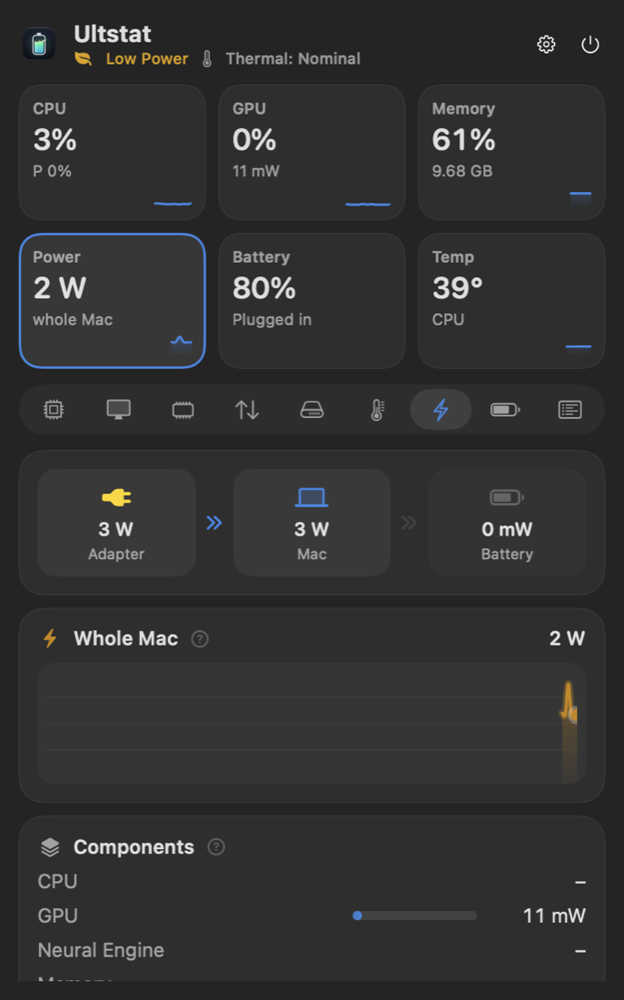
&nbsp;
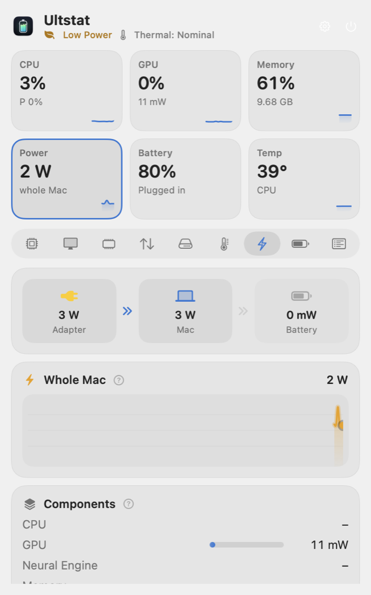

</div>

---

Ultstat combines a menu-bar system monitor (CPU, GPU, memory, disk, network, temperatures, power, fans, processes) with full battery care: charge limit, sailing, discharge, heat protection, top-up and calibration. It's designed for the case where it runs all day in the background, so its own power draw is the first feature.

## Download

| | |
|---|---|
| **Ultstat 0.1.0 for macOS** | [`Ultstat-0.1.0.dmg`](../../releases/latest) from the Releases page (2.2 MB) |
| **Requires** | macOS 26 or later on Apple silicon (developed on a MacBook Air M5, macOS 27.0.1) |
| **Not available for** | Intel Macs, Windows or Linux. Ultstat talks to the Apple silicon SMC, IOReport and IOKit directly |

1. Open the DMG and drag **Ultstat** to **Applications**.
2. The build is ad-hoc signed, not notarized, so the first time **right-click → Open** (or *System Settings → Privacy & Security → Open Anyway*).
3. If you use a menu-bar manager (Bartender, Ice, Latch …), ⌘-drag Ultstat out of its hidden section.
4. Monitoring works straight away. For charge control, open **Settings → Charge Control → Install** and approve the helper with your password.

## Screenshots

Every module has its own panel. Click a reading in the menu bar to open it. These are rendered by the app itself
(`-UltstatSnapshotDir`) from live readings on a MacBook Air M5:

<p align="center">
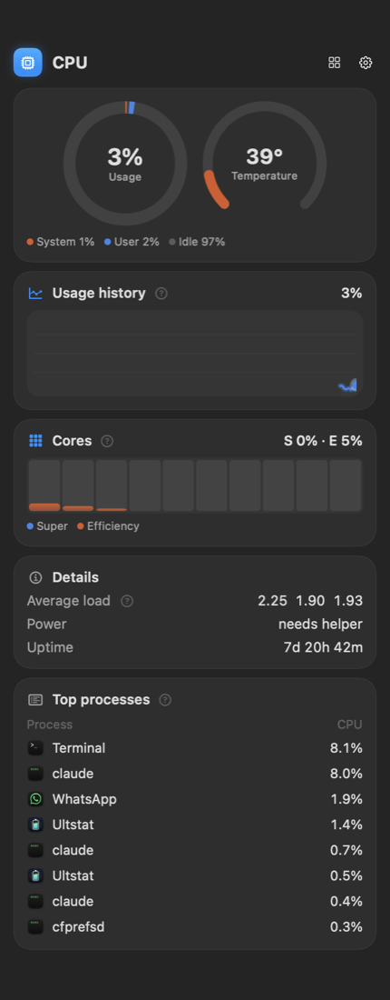
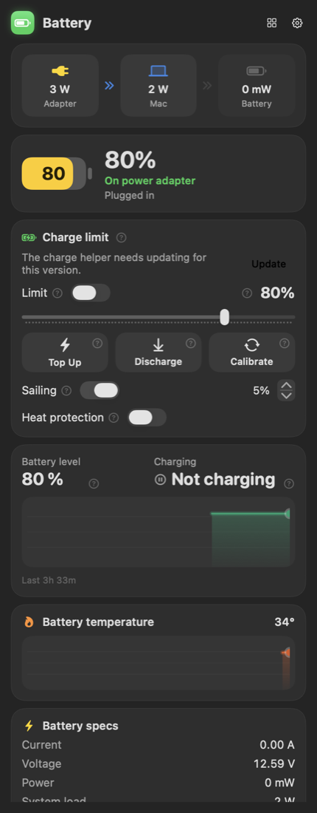
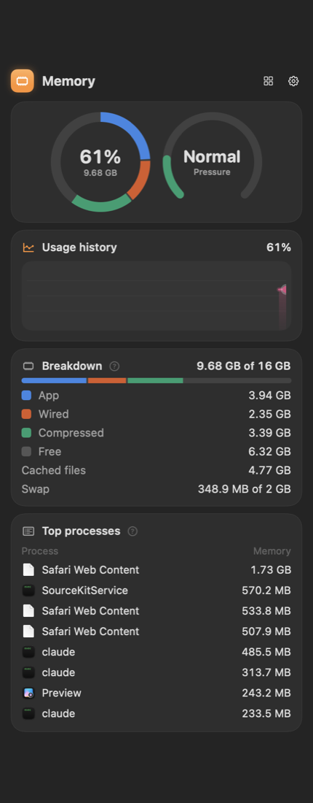
</p>
<p align="center">
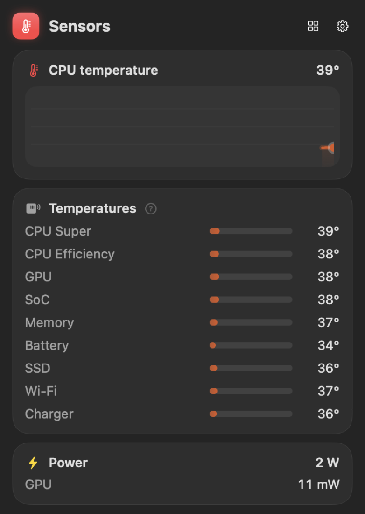
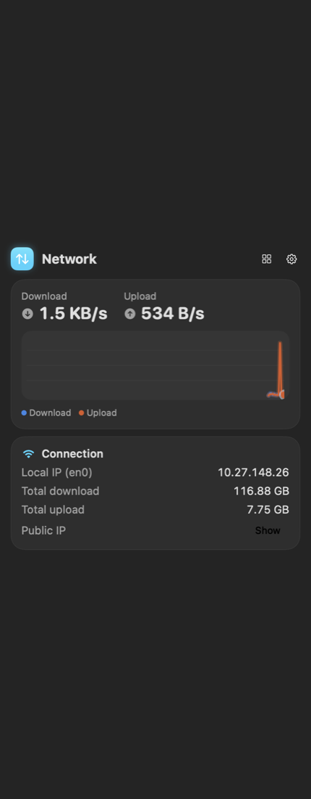
</p>

**Menu bar settings.** Pick readings and styles, then drag them in the preview to rearrange; the menu bar follows on drop.

<p align="center">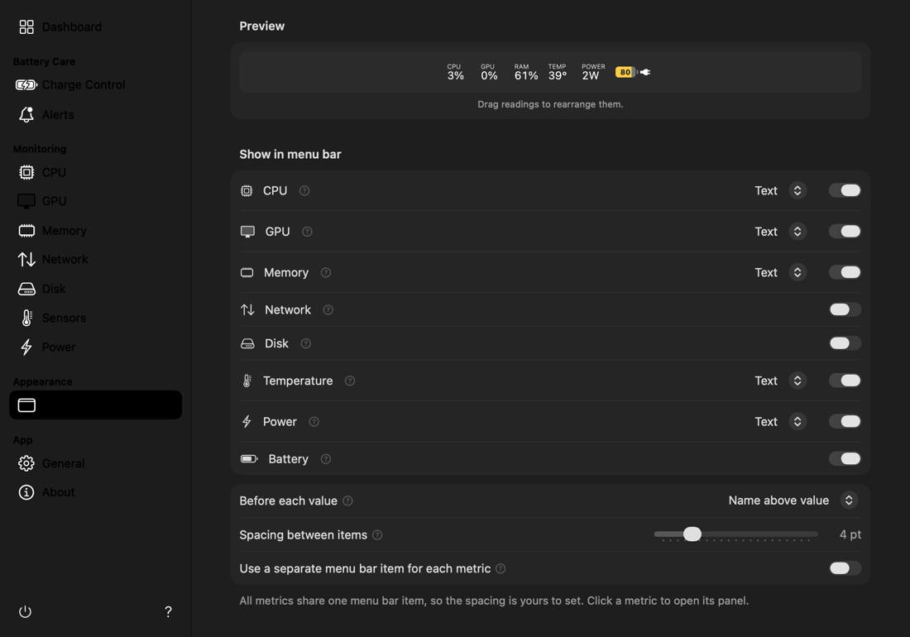</p>

**Battery icon states:** on adapter, charging, Low Power Mode.

<p align="center">

&nbsp;
&nbsp;
</p>

## Measured cost

MacBook Air M5, macOS 27.0.1. Default menu bar (CPU, memory, temperature, battery), popover closed, 30 s of `powermetrics --samplers tasks`:

| | CPU time | Wake-ups | Energy impact | Memory |
|---|---|---|---|---|
| **Ultstat** | **0.85 ms/s** | **0.56 /s** | **0.08** | **15 MB** |
| Stats 3.0.20 | 56.8 ms/s | 9.0 /s | 7.09 | 151 MB |
| AlDente 1.39.4 | 9.6 ms/s | 2.9 /s | 1.27 | 80 MB |

How it gets there:

- **One timer for everything**, aligned and coalescable, cancelled entirely when nothing is visible or the display sleeps.
- **Demand-driven sampling.** A metric is read only while a menu-bar item or open view shows it.
- **No child processes.** Processes come from `libproc`, not `ps`/`top`; network from per-interface `IFMIB` sysctls (3 µs, versus 578 µs for the naive approach).
- **SMC, not IOHID, for temperatures**: about 200 µs per sensor and only 16 µs of CPU, versus about 760 µs. Sensors are read in a rotating window.
- **Event-driven battery.** IOKit notifications, no polling.
- **Menu bar drawn into a `CALayer`.** No AppKit re-rasterisation; the item width is fixed so it never relayouts.
- **SwiftUI exists only while a window is open.**

Every number above, and the method behind it, is in [`PROGRESS.md`](PROGRESS.md).

## Features

**Monitor:** total and per-core CPU (performance/efficiency split), GPU utilisation and power, memory (app/wired/compressed, swap, pressure), disk throughput and capacity, network throughput, temperatures grouped by component, system power, fans, top processes by CPU, memory or measured energy, Bluetooth accessory batteries, thermal state and Low Power Mode.

**Battery:** the macOS percentage alongside the fuel gauge's real charge, health and cycle count, live power flow (adapter → Mac ← battery).

**Charge control** (needs the privileged helper):
- charge limit (20–100 %) with sailing range
- discharge to the limit while plugged in
- heat protection with hysteresis
- one-shot top-up to 100 %
- calibration cycle
- MagSafe LED control

The limit holds while the app is quit, through sleep and across reboots.

## How charge control works

Apple has changed the mechanism several times. Ultstat detects which one your Mac has by probing the SMC rather than checking the OS version:

| Firmware | Mechanism |
|---|---|
| Legacy Apple Silicon | SMC `CH0B`/`CH0C` (inhibit), `CH0I` (adapter) |
| macOS 26 firmware | SMC `CHTE` (inhibit), `CHIE` (adapter) |
| macOS 27 (M5 tested) | macOS's own charge limiter driven through its preferences, plus `CHIE` |

Details, byte layouts and open questions are in [`docs/charging-control.md`](docs/charging-control.md).

### Safety

- The helper accepts XPC connections only from Ultstat, verified by code signature (team ID, or the exact cdhash of the containing app for unsigned builds).
- Its interface is a few range-checked commands. Unlike AlDente's helper, it has no "write any SMC key" or "write any preference" call.
- It restores normal charging on exit and uninstall. It never leaves the adapter disabled while unplugged, a property tested exhaustively across about 50,000 input combinations.

## Architecture

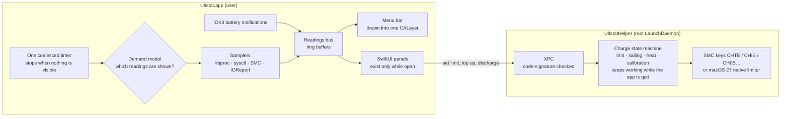

## Proof

**Power.** `powermetrics --samplers tasks`, 30 s, default menu bar, popover closed (raw numbers and method in
[`PROGRESS.md`](PROGRESS.md)). Ultstat uses about 1/67th of the CPU time of Stats and 1/11th of AlDente:

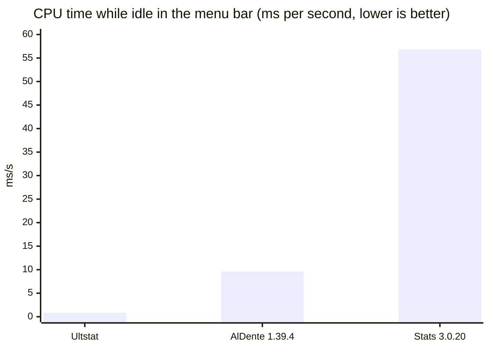

**How the idle cost came down** across the build iterations:

| Build | CPU ms/s | Wake-ups/s | Energy impact |
|---|---:|---:|---:|
| First build | 8.38 | 5.36 | 1.01 |
| Cached symbols and attributes, rasterise once, fixed slots | 5.55 | 5.21 | 0.60 |
| `CALayer` contents instead of `NSStatusBarButton.image` | 1.07 | 0.59 | 0.13 |
| Current (demand-driven sampling, event-driven battery) | **0.85** | **0.56** | **0.08** |

**Tests.** 96 of 96 pass on the 0.1.0 build: 61 for the core (samplers, scheduler, the charge state machine against
a fake SMC) and 35 for the app logic (settings, menu-bar layout, battery time).

```text
$ cd Packages/UltstatCore && swift test
✔ Test run with 35 tests in 10 suites passed after 0.142 seconds.
✔ Test run with 61 tests in 19 suites passed after 1.489 seconds.
```

**Memory.** `tools/stress-popover.sh` opens and closes the popover 120 times: memory stays bounded at 44 MB. An earlier build grew by 0.75 MB per open
(a glyph cache filled by animated number transitions); the stress test caught it and it is fixed.

## Requirements

- Apple Silicon Mac
- macOS 26 or later

## Build

```sh
brew install xcodegen
xcodegen generate
xcodebuild -project Ultstat.xcodeproj -scheme Ultstat -configuration Release build
```

To build and install for daily use, run `tools/install-local.sh`. It signs the app with a local
self-signed certificate (kept in its own keychain), so the charge helper trusts that certificate
rather than one exact build: you approve the helper once, and later updates keep working without
another password prompt.

Tests:

```sh
cd Packages/UltstatCore && swift test
```

The tests use real hardware where they can; the charge controller is tested against a fake SMC.

Useful tools:
- `swift run -c release ultstat-smc list` — every SMC key on this Mac, decoded
- `swift run -c release ultstat-bench` — micro-benchmarks of each sampler
- `tools/stress-popover.sh 60` — opens and closes the popover 60 times, then reports memory and leaks
- Launch with `-UltstatSnapshotDir /tmp/shots` to render the menu bar, dashboard and settings to PNG

## Project layout

```
App/                      AppKit shell, SwiftUI popover and settings
Helper/                   privileged LaunchDaemon (charge control)
Shared/                   XPC protocol
Packages/UltstatCore/
  Sources/CSMC            allocation-free AppleSMC client (C)
  Sources/CPrivate        IOHID/IOReport declarations and shim
  Sources/UltstatCore     samplers, scheduler, charge state machine and actuators
  Sources/UltstatKit      app logic: readings bus, settings, menu-bar renderer
docs/                     charge-control notes, assets
tools/                    icon renderer, stress script
```

## License

Apache License 2.0. See [`LICENSE`](LICENSE) and [`NOTICE`](NOTICE).

---

Made by **Kamalesh VS** · [github.com/kkjjkamal123](https://github.com/kkjjkamal123) · [kkjj.me](https://kkjj.me)
